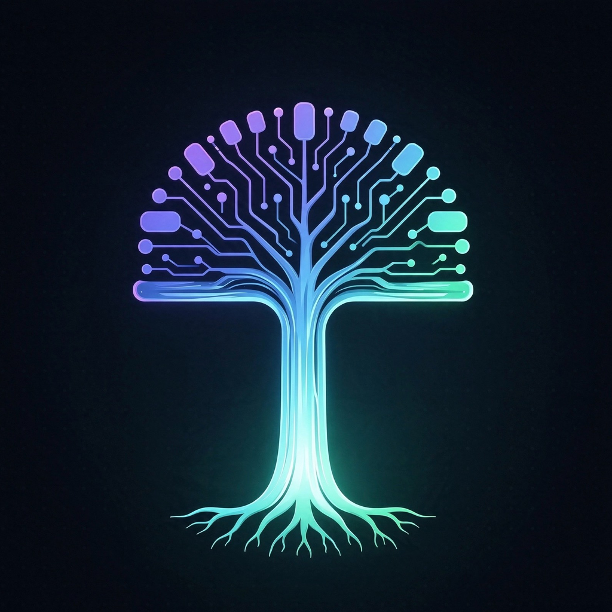
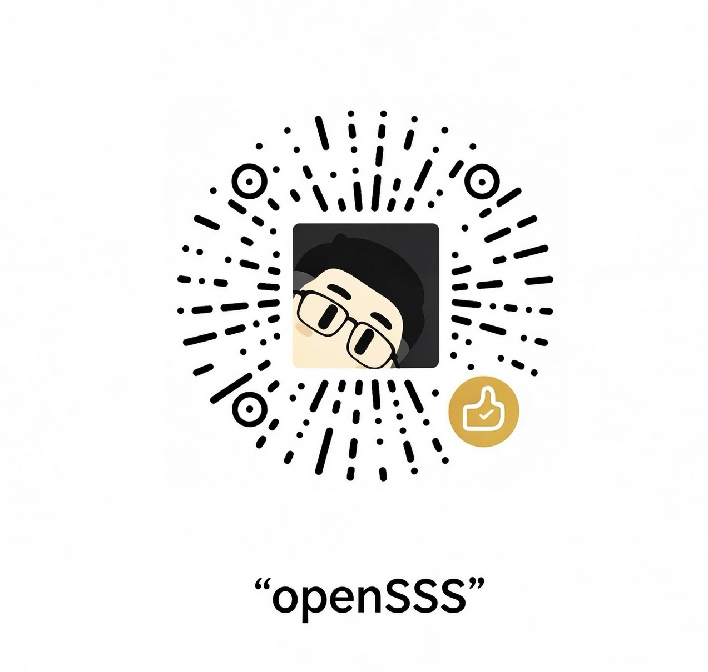

<div align="center">



# 🌲 TreeNewBee（树应用）

### 一个侧载位，长出一整棵应用树 —— LiveContainer 宿主 + 内置 openSSS，合成一个 IPA。

**免费证书只给三个位，那就别一个一个装，把整片森林塞进一个位里。🌲**

> 侧载这题，咱还是版本答案。🃏

[](https://github.com/SheldonJoO/TreeNewBee/releases/latest)
[](LICENSE)
[](#)

**[⬇️ 下载安装 IPA](https://github.com/SheldonJoO/TreeNewBee/releases/latest)** · **[🐦 关注 X @SheldonJo_O](https://x.com/SheldonJo_O)** · **[💬 反馈 Issue](https://github.com/SheldonJoO/TreeNewBee/issues)**

</div>

---

## 🔥 为什么是版本答案

个人免费 Apple ID 只给 **3 个 App ID / 3 个侧载位**，装一个 SideStore 就少一个装 App 的地方。

常规解法是「装哪个、删哪个」，TreeNewBee 的解法是把它们叠起来：

- **一个 IPA，两个身份** —— LiveContainer 当宿主，[openSSS](https://github.com/SheldonJoO/openSSS) 作为 in-process guest 直接跑在里面，共用同一个 App ID、同一份签名、同一个侧载位
- **Guest App 不占名额** —— 容器里装多少个 IPA 都不吃 App ID，还能同 App 多开、多数据容器
- **签名权留在手机** —— 内置 openSSS 负责证书、刷新、续签，不用为了装新 App 回电脑
- **中文是一等公民** —— 界面、设置分类、工具箱、小组件全部中文，不是英文之上贴一层翻译

名字取自那棵树：主根是 LiveContainer，枝干上挂 openSSS，叶子是你在容器里装的所有 App。

## ✨ 功能

| 功能 | 说明 |
|---|---|
| 🌲 **单侧载位双开** | TreeNewBee + 内置 openSSS 共用一个 App ID / 一份签名 |
| 📲 **无限 Guest App** | 容器里装任意多个 IPA，不受免费账号 3 App 限制；支持多版本共存、独立数据容器 |
| 🔑 **证书导入导出** | 设置 → 证书管理，导入 / 导出 `.p12`（带密码），容器与内置 openSSS 共用 |
| 🧰 **工具箱** | 手机信息（型号 / 系统 / 容量 / 销售地区 / 处理器 / 分辨率 / IP）、屏蔽 iOS 更新 |
| 🚫 **屏蔽 iOS 更新** | 直连[爱思版](https://d-updater.i4.cn/web/mobileconfig/iOS26.mobileconfig) / [尝鲜派版](https://media.sunbelife.com/2026-06-04-noota-26.mobileconfig)官方描述文件，Safari 下载后到系统设置安装 |
| 🪟 **桌面 / 锁屏小组件** | 显示 TreeNewBee 里装的 App，点一下直接打开；可手动勾选要显示哪些 |
| 🎬 **启动过渡页** | 从小组件 / 深链启动 App 时先盖品牌过渡页，中间的唤醒、切 Tab、openSSS 启动页、已安装应用页全被遮住 |
| 🔙 **悬浮返回按钮** | 在 guest App 里随时切回 TreeNewBee |
| 🎨 **主题 / 图标网格** | 网格与列表两种 App 排布、主题配色、深色模式 |
| 🌏 **多语言切换** | 简中 / 繁中 / 英 / 日 / 韩 / 泰 / 马来 / 印尼语等，App 内直接切 |
| ➕ **侧载到桌面** | App 页加号菜单一键唤起内置 openSSS，不用再找图标 |

> Tab 只有两个：**App** 和**设置**。之前试过给 openSSS 单独开第三个 Tab，误触太狠，已撤销，入口收敛到 App 列表首格和加号菜单。

## 📦 安装（首次）

1. 用 [iloader](https://github.com/nab138/iloader) / SideStore / AltStore 等任意侧载工具，把 [TreeNewBee 最新 IPA](https://github.com/SheldonJoO/TreeNewBee/releases/latest) 签上装进手机 —— **只占 1 个侧载位**
2. 首次打开 → **设置 → 证书管理 → 导入签名证书**，选电脑侧载工具导出的 `.p12` 并填密码，内置 openSSS 就能用它续签
3. 想用内置 openSSS 侧载：App 页右上角 **➕ → 侧载到桌面**，或点列表首格的 openSSS 图标
4. 想屏蔽系统更新：工具箱 → **屏蔽 iOS 更新** → Safari 下载描述文件 → **设置 → 通用 → VPN 与设备管理** 安装 → 重启

> ⚠️ 合体包内的 openSSS 是 guest，**不需要、也不要再单独装一个 openSSS IPA**，那会白白吃掉一个侧载位。
>
> ⚠️ 描述文件由 Safari 下载、系统设置安装，App 无法代装。两个链接都是官方 https 源，别用第三方转发地址。

### 小组件怎么配

1. 桌面长按 → **＋** → 搜 `TreeNewBee`，添加桌面或锁屏小组件
2. App 内 **设置 → 小组件 App**，勾选要显示的 App（含内置 openSSS），点保存立即刷新

> ⚠️ 如果你之前手动勾过 App，新增的**内置 openSSS 不会自动冒出来**。要么把它也勾上，要么点「清除选择（恢复自动显示全部）」。
>
> 数据源是 TreeNewBee 自己安装的 Guest App（扫盘 + App Group + Keychain 快照三通道），**不会**误把 openSSS 侧载到桌面的 App 混进来。

## 🔨 从源码构建

要求：macOS + Xcode（含 CommandLineTools）、`ldid`、`xcodegen`、`rsync`、`Dependencies/OpenSSL.xcframework`，以及一份 [openSSS 未签名 IPA](https://github.com/SheldonJoO/openSSS/releases/latest)。

```sh
git clone https://github.com/SheldonJoO/TreeNewBee.git
cd TreeNewBee
# 把 OpenSSL.xcframework 放进 Dependencies/
./local-build-openSSS.sh /path/to/openSSS.ipa
```

产物：`TreeNewBee-<时间戳>.ipa`（device arm64 + hook，**仅真机，不支持模拟器**）。

打包脚本会自动完成：注入 `.lproj` 与 `CFBundleLocalizations`、替换 widget、把 `CFBundleVersion` 统一成字符串、移除 `SideStoreApp.framework/PlugIns`、清掉 `_CodeSignature` / `CodeResources`，并把内置 openSSS 的 IPA 资源塞进合体包。

> ⚠️ 别手工改 IPA 里的签名目录。`SideStoreApp.framework` 本质是 APPL 包，往里加资源会破坏 `CodeResources`，侧载直接报 `0xe8008017`。

### 为什么技术标识符一个都不能改

品牌只换显示层，下面这些是 host 与 guest 之间的「暗号」，改一个就断链：

| 标识符 | 值 / 说明 |
|---|---|
| Bundle ID | `com.kdt.livecontainer` |
| URL Scheme | `livecontainer://`，小组件深链 `livecontainer-launch` 走它 |
| App Group | 宿主、内置 openSSS、widget 共享同一容器 |
| Keychain service | 证书与小组件快照 `snapshot.v2` 的通道 |
| 包结构 | `TreeApps.app`、可执行名、AppIntent mangled name 全部保持上游原样 |

改名会导致：guest 找不到数据容器、小组件读不到 App 列表、证书丢、深链失效。想换名字，只改 `Info.plist` 的显示名和本地化字符串。

## 🧬 开源血缘与许可证

| 来源 | 作用 | 许可证 |
|---|---|---|
| [LiveContainer](https://github.com/LiveContainer/LiveContainer) | 宿主底座：guest 环境、dlopen 可执行、多数据容器、SwiftUI 界面 | AGPLv3 |
| [SideStore](https://github.com/SideStore/SideStore) | 手机端签名、Anisette、应用源，openSSS 的上游 | AGPLv3 |
| [AltStore](https://github.com/rileytestut/AltStore) | 签名框架与应用模型的上游原版 | AGPLv3 |
| [openSSS](https://github.com/SheldonJoO/openSSS) | 本项目内置的 in-process guest，中文优先的侧载工具 | AGPLv3 |
| [iloader](https://github.com/nab138/iloader) | 首次 USB 安装（可选，仅冷装机） | MIT |

本项目以 **AGPLv3** 发布，上游 LICENSE、版权头与署名全部保留。

Fork 点：LiveContainer 上游 nightly / `b0f53e8`。为便于维护，拉出后重建为**单根提交**，上游历史未保留；[上游原始 README 存档](./UPSTREAM-README.md)。

## 🤝 参与

欢迎提 Issue / PR，尤其是真机上的兼容性反馈。

注意：如果要贡献回上游 LiveContainer 或 SideStore，请先读上游对 AI 生成内容的贡献限制，与维护者的沟通必须是人类对人类。

## 🙏 致谢

站在这些人的肩膀上：

- **LiveContainer 全体贡献者** —— 尤其是 SwiftUI 界面的 @hugeBlack，以及 guest 加载 / 多任务那套机制
- **Riley Testut** —— AltStore 原作者，整个 iOS 侧载生态的起点
- **SideStore 全体贡献者** —— 手机端签名与 Anisette 的地基
- **nab138** —— iloader，让首次安装变得简单
- **jkcoxson** —— minimuxer / em_proxy / idevice
- **Seal** —— 灵感来源（闭源，未使用其任何代码或二进制）

## ☕ 请作者喝杯咖啡

如果这玩意儿省了你折腾证书和侧载位的功夫，欢迎点个饭 —— 你的支持是我继续维护更新的燃料 🍚

<div align="center">
  
</div>

## 📢 关注我，别错过下一版

新版本、踩坑记录、其他折腾项目都发在这儿，求波关注 👇

- **X / Twitter** [@SheldonJo_O](https://x.com/SheldonJo_O) —— 新版本首发、踩坑记录
- **GitHub** [SheldonJoO](https://github.com/SheldonJoO) —— 顺手点个 Star ⭐

---

<div align="center">
  <sub>Made with ☕ and 折腾 · 🌲 TreeNewBee · AGPLv3</sub>
</div>
